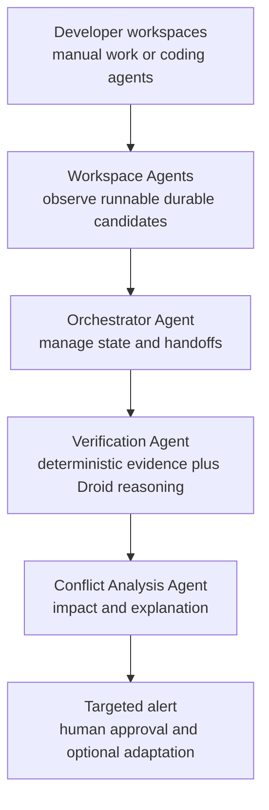

# InSync — Initial Architecture

## Status

This is the initial agentic architecture for the InSync prototype. The evidence and coordination contracts should remain stable while the exact Droid SDK runtime, tools, and permissions are confirmed.

## Status labels

- **[BUILD NOW]** — stable implementation boundary.
- **[DROID-DEPENDENT]** — likely to change after the Factory discussion.
- **[SCENARIO-DEPENDENT]** — depends on the final demo repository and conflict.
- **[DEFERRED]** — not part of the first implementation.

## Design goals

- Observe local work before push or merge.
- Verify claims against actual repository evidence.
- Share metadata and evidence references by default.
- Use deterministic evidence handling and bounded agentic reasoning to detect one meaningful risk.
- Notify only the affected developer.
- Keep the demo local, repeatable, and resettable.
- Allow manual developers and coding agents to use the same workflow.

## Provisional system view



## Components

### Workspace Agent — [BUILD NOW]

Responsibilities:

- Identify repository and workspace.
- Read branch and base commit.
- Capture uncommitted diff or local commit metadata.
- Check whether uncommitted work is runnable, meaningful, and durable enough to be commitment-likely.
- Record dwell time and explicit publish intent when available.
- Create a change manifest.
- Send the manifest to the service.

The first implementation may be a CLI command instead of a background watcher. This is a logical agent boundary, not a requirement for an LLM running on every developer laptop.

### Workspace registry — [BUILD NOW]

Tracks:

- Developer identity
- Workspace identity
- Repository
- Branch
- Base commit
- Visibility scope
- Last observation time

### Ingestion API — [BUILD NOW]

Suggested endpoints:

```text
POST /workspaces/register
POST /observations
GET  /workspaces/{workspace_id}/alerts
POST /alerts/{alert_id}/outcome
GET  /health
```

The API should use idempotency keys or equivalent duplicate protection for observations.

### Orchestrator Agent — [BUILD NOW]

Responsibilities:

- Receive candidate observations.
- Decide which agent should run next.
- Maintain the observation, verification, analysis, alert, and outcome states.
- Request additional evidence when a decision is inconclusive.
- Apply retry, timeout, and deterministic fallback behavior.

The first implementation can be a service module and state machine inside FastAPI.

### Verification Agent — [BUILD NOW] / [DROID-DEPENDENT]

Responsibilities:

- Re-check repository and branch identity.
- Validate evidence references.
- Validate runnable status, dwell time, and admission policy.
- Reject stale or unsupported claims.
- Attach verification status and timestamp.
- Preserve provenance.
- Optionally invoke Droid with read-only, verified context to assess whether the work represents a meaningful change.

Deterministic checks are authoritative for provenance. Droid can provide bounded reasoning, but it cannot invent or override missing evidence.

### Shared context store — [BUILD NOW]

The store should persist:

- Workspaces
- Observations
- Evidence
- Detected risks
- Alerts
- Outcomes

PostgreSQL remains the preferred relational design from the workbook, but the storage choice may be simplified if setup becomes a time risk.

### Conflict Analysis Agent — [BUILD NOW] / [DROID-DEPENDENT]

Use a pluggable detector and reasoning interface:

```text
Detector.analyze(observation, active_workspaces) -> candidate_findings
ConflictAgent.explain(verified_context) -> structured_decision
```

Initial detectors:

- Direct overlap detector
- One scenario-specific semantic detector

Droid may reason over the candidate findings and verified context, classify known or new risk categories, request more evidence, and explain why a particular workspace is affected. The policy layer validates that every alert is grounded in real evidence.

Future detectors may cover dependency propagation and integration-test failure.

### Notification adapter — [BUILD NOW]

The first notification path may be:

- CLI output
- VS Code warning notification
- VS Code evidence panel

Alerts should be delivered to the affected developer, not broadcast to all workspaces.

### Optional Adaptation Agent — [DROID-DEPENDENT]

After human approval, invoke Droid in an isolated worktree to propose or apply an adaptation. Capture its plan, diff, commands, and tests as evidence. The shared developer worktree is not modified automatically.

### VS Code extension — [BUILD NOW]

Keep the extension thin:

- Watching status
- Publish command
- Active-alert command
- Evidence view
- Acknowledge or dismiss action

The extension should call the local service rather than contain the detection logic.

## Droid integration boundary

### Droid adapter boundary — [DROID-DEPENDENT]

Keep Droid in a separate TypeScript/Node adapter or process. Do not make the Python service depend directly on undocumented SDK behavior.

Possible boundary:

```text
FastAPI service ←→ Node/TypeScript Droid adapter ←→ Droid SDK / daemon
```

The adapter should expose role-specific operations such as:

```text
verify_candidate(context) -> VerificationDecision
analyze_conflict(context) -> ConflictDecision
propose_adaptation(context) -> AdaptationPlan
```

Each operation should use a strict structured-output schema and a bounded tool/permission policy.

### Candidate integration models

#### Model A: Droid as a developer-side coding agent

Droid performs a task in Developer A's worktree. The local collector observes the resulting change.

This can create real repository changes for the demo, but it is not the primary InSync agentic role.

#### Model B: InSync invokes Droid for analysis

After a Workspace Agent and deterministic Verification Agent admit a change, InSync asks Droid to inspect the verified context and return a structured verification, impact, explanation, or next-action decision.

This is the preferred integration model. It introduces runtime, session, permissions, cost, and latency dependencies that must be bounded for the demo.

#### Model C: Droid calls InSync as a tool

Expose a verified-context function or MCP tool that Droid can call while analyzing a change. Droid retrieves relevant teammate metadata and evidence references through InSync rather than receiving arbitrary shared source.

This may be conceptually strong but requires confirming the SDK's tool and MCP integration path.

#### Model D: Human-approved Droid adaptation

The developer approves an InSync alert, then InSync asks Droid to propose or apply a change in an isolated worktree. The resulting diff and tests become visible evidence.

This is attractive for the demo but should remain optional until permission and worktree-control behavior are understood.

## Data flow

```text
1. Register workspace
2. Observe local work
3. Admit commitment-likely candidate
4. Verify repository evidence
5. Orchestrator selects verification and analysis steps
6. Compare against other active work
7. Droid and detectors explain impact when needed
8. Route targeted alert
9. Record developer outcome
10. Optionally run human-approved adaptation
```

## Interfaces to freeze now

These should be designed before the Droid discussion because they are useful regardless of the final integration:

- Workspace registration schema
- Change manifest schema
- Evidence item schema
- Risk finding schema
- Alert schema
- Outcome schema
- Detector interface
- Agent decision and handoff schemas
- Admission-policy schema
- Reset and replay interface

## Interfaces not to freeze yet

- Droid session lifecycle and prompt format
- Droid tool permissions
- Droid-to-InSync message format
- Automatic adaptation API
- Agent-specific VS Code commands

## Security and privacy assumptions

- API keys must never be committed or placed in frontend code.
- Raw unfinished source should not be shared by default.
- Evidence references should identify the source without exposing more code than necessary.
- Local demo credentials should be stored outside the repository.
- A production deployment is outside the current scope.

